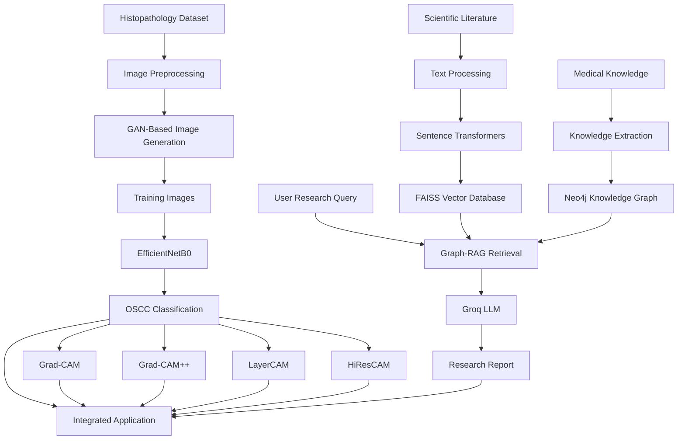

# 🦷 GAN-Based Oral Cancer Detection with Graph-RAG & Grad-CAM

<p align="center">
  
  
  
  
  
  
</p>

<p align="center">
  <b>An AI-assisted histopathology research framework integrating deep learning, generative models, explainable AI, and knowledge graph-based retrieval.</b>
</p>

<p align="center">
  <a href="#-overview">Overview</a> •
  <a href="#-application-preview">Application</a> •
  <a href="#-architecture">Architecture</a> •
  <a href="#-methodology">Methodology</a> •
  <a href="#-installation">Installation</a>
</p>

---

## 📌 Overview

Oral Squamous Cell Carcinoma (OSCC) is a major form of oral cancer that requires careful histopathological examination.

This project presents an integrated **GAN-Based Deep Learning Framework with Graph-RAG for Oral Cancer Detection**, combining computer vision, generative modeling, explainable AI, and knowledge retrieval into a unified research application.

The system goes beyond conventional image classification by connecting visual predictions with explainability techniques, scientific literature, structured medical knowledge, and LLM-powered research reporting.

### ✨ What makes this project different?

| Module | Implementation |
|:---|:---|
| Image Generation | WGAN, HistoGAN, CycleGAN |
| Image Classification | EfficientNetB0 |
| Explainable AI | Grad-CAM, Grad-CAM++, LayerCAM, HiResCAM |
| Semantic Retrieval | FAISS |
| Text Embeddings | Sentence Transformers |
| Knowledge Graph | Neo4j |
| LLM Inference | Groq |
| Research Reporting | Context-aware LLM generation |

---

# 🖥️ Application Preview

An interactive research interface allows users to upload histopathological images, examine model predictions, explore attribution visualizations, and retrieve contextual medical research information.

## 01. Image Upload & Case Analysis

Upload an oral histopathology image and provide optional clinical context, including age, sex, tobacco use, alcohol use, lesion site, and magnification.

The application prepares the image for EfficientNetB0 inference and subsequent research analysis.

<p align="center">
  
</p>

<p align="center">
  <sub><b>Figure 1.</b> AI-assisted histopathology image upload and case analysis interface.</sub>
</p>

## 02. Explainable AI – Model Interpretability

The application provides four attribution techniques to investigate which image regions influence the classification output.

<p align="center">
  
</p>

<p align="center">
  <sub><b>Figure 2.</b> Comparison of four explainability methods on an OSCC histopathology image.</sub>
</p>

**Supported XAI techniques:**

- **Grad-CAM:** Gradient-based class activation visualization.
- **Grad-CAM++:** Improved class-specific localization.
- **LayerCAM:** Layer-wise activation mapping.
- **HiResCAM:** High-resolution class activation mapping.

The interface also presents attribution statistics such as normalized mean, 90th percentile, and attribution area fraction.

## 03. AI-Generated Research Report

The research reporting module combines the classification output, XAI attribution statistics, retrieved literature, and knowledge graph context.

<p align="center">
  
</p>

<p align="center">
  <sub><b>Figure 3.</b> Contextual research report generated using retrieved evidence and Groq LLM inference.</sub>
</p>

**Research report includes:**

- Case summary and model prediction.
- XAI attribution analysis.
- Knowledge graph context.
- Retrieved scientific literature.
- Integrated research interpretation.

---

# 🏗️ Architecture

The framework combines four major components:

1. GAN-based image generation.
2. EfficientNetB0 image classification.
3. Explainable AI visualization.
4. Graph-RAG-powered research retrieval.

## System Workflow



## 🔄 Application Pipeline

| Step | Component | Function |
|:---:|:---|:---|
| 01 | Image Inference | EfficientNetB0 predicts the image category. |
| 02 | XAI Analysis | Four attribution methods visualize model behavior. |
| 03 | Evidence Retrieval | FAISS retrieves relevant scientific literature. |
| 04 | Graph Context | Neo4j contributes structured knowledge. |
| 05 | Research Synthesis | Groq generates a contextual research report. |

---

# 🧠 Methodology

## 1. GAN-Based Image Generation

Generative Adversarial Networks are explored to generate synthetic histopathological images and investigate their potential to improve dataset diversity.

**Models explored:**

- Wasserstein GAN (WGAN)
- HistoGAN
- CycleGAN

### CycleGAN Experimental Results

| Metric | Result |
|:---|---:|
| Training Epochs | 100 |
| Mean Absolute Error | 0.0918 |
| Identity Loss | 0.0600 |

These metrics represent image-generation experiments, not classification performance.

## 2. EfficientNetB0 Classification

EfficientNetB0 is used as the primary convolutional neural network for histopathological image classification.

**Prediction categories:**

- Normal
- Oral Squamous Cell Carcinoma (OSCC)

The model produces a classification score and applies a configured decision threshold to determine the predicted category.

## 3. Explainable AI

Four XAI techniques are integrated to investigate model attribution:

| Method | Main Purpose |
|:---|:---|
| Grad-CAM | Class-specific visual explanations |
| Grad-CAM++ | Refined gradient-based localization |
| LayerCAM | Layer-wise visual attribution |
| HiResCAM | High-resolution attribution maps |

The framework allows researchers to compare different attribution methods rather than relying on a single visualization.

## 4. Graph-RAG Knowledge Retrieval

The knowledge retrieval module combines vector similarity search with graph-based knowledge exploration.

### FAISS – Semantic Retrieval

FAISS provides efficient similarity-based retrieval over scientific literature embeddings.

Workflow:

1. Process scientific literature.
2. Generate embeddings using Sentence Transformers.
3. Store embeddings in a FAISS index.
4. Retrieve relevant literature using semantic similarity.

### Neo4j – Knowledge Graph

Neo4j represents medical concepts and their relationships in a structured graph.

It supports:

- Connected medical knowledge representation.
- Relationship-based retrieval.
- Exploration of OSCC-related concepts.
- Contextual knowledge retrieval.

### Groq – LLM Integration

Groq provides LLM inference for research report generation.

The retrieved literature and graph context are integrated with the model output to generate a contextual research report.

---

# 📊 Dataset

**Dataset:** [Oral Cancer Dataset – Kaggle](https://www.kaggle.com/datasets/ashenafifasilkebede/dataset)

The dataset contains two histopathological image categories:

| Class | Description |
|:---|:---|
| OSCC | Oral Squamous Cell Carcinoma |
| Normal | Normal oral tissue |

### Dataset Distribution

| Split | OSCC | Normal |
|:---|---:|---:|
| Training | 2,511 | 2,435 |
| Validation | 92 | 28 |
| Testing | 95 | 31 |
| **Total** | **2,698** | **2,494** |

---

# 📈 Experimental Results

| Experiment | Implementation / Result |
|:---|:---|
| WGAN | Explored |
| HistoGAN | Explored |
| CycleGAN | Experimental results obtained |
| EfficientNetB0 | Image classification |
| Grad-CAM | Implemented |
| Grad-CAM++ | Implemented |
| LayerCAM | Implemented |
| HiResCAM | Implemented |
| FAISS | Semantic retrieval |
| Neo4j | Knowledge graph |
| Groq | LLM inference |

*Classification accuracy, precision, recall, F1-score, and confusion matrix should be added after final evaluation. GAN reconstruction metrics must not be interpreted as classification metrics.*

---

# 📂 Project Structure

```text
GAN-based-Oral-Cancer-detection-with-GraphRag-GradCam/
│
├── assets/
│   └── Model Screenshots/
│       ├── Screenshot 2026-11-20 110230.png
│       ├── Screenshot 2026-11-20 110652.png
│       └── Screenshot 2026-11-20 110716.png
│
├── knowledge_base/
│
├── models/
│
├── notebooks/
│
├── results/
│
└── README.md
```

---

# ⚙️ Technology Stack

<p align="center">
  
</p>

| Technology | Application |
|:---|:---|
| Python | Core programming |
| TensorFlow / Keras | Deep learning |
| EfficientNetB0 | Image classification |
| GANs | Synthetic image generation |
| Grad-CAM Family | Explainable AI |
| FAISS | Vector similarity search |
| Sentence Transformers | Semantic embeddings |
| Neo4j | Graph database |
| Groq | LLM inference |
| OpenCV | Image processing |
| NumPy / Pandas | Data processing |

---

# 🚀 Installation & Setup

## Prerequisites

- Python 3.10+
- Jupyter Notebook
- TensorFlow / Keras
- Neo4j database
- Groq API access
- Required trained model files and knowledge-base resources

### 1. Clone the Repository

```bash
git clone https://github.com/SayyadRizwan/GAN-based-Oral-Cancer-detection-with-GraphRag-GradCam.git

cd GAN-based-Oral-Cancer-detection-with-GraphRag-GradCam
```

### 2. Create a Virtual Environment

```bash
python -m venv venv
```

**Windows:**

```bash
venv\Scripts\activate
```

**Linux / macOS:**

```bash
source venv/bin/activate
```

### 3. Install Dependencies

```bash
pip install tensorflow numpy pandas matplotlib scikit-learn
pip install opencv-python pillow
pip install faiss-cpu sentence-transformers
pip install neo4j groq python-dotenv jupyter
```

Install any additional dependencies required by the individual notebooks and application.

### 4. Configure Environment Variables

Create a `.env` file in the root directory:

```env
GROQ_API_KEY=your_groq_api_key

NEO4J_URI=your_neo4j_uri
NEO4J_USERNAME=your_neo4j_username
NEO4J_PASSWORD=your_neo4j_password
```

**Security:** Never commit API keys, passwords, or other credentials to GitHub.

### 5. Run Experiments

```bash
jupyter notebook
```

Navigate to the `notebooks/` directory and execute the relevant notebooks according to their dependencies.

Use the application entry point provided in the source code to launch the integrated interface.

---

# 🔮 Future Enhancements

- Compare additional CNN architectures.
- Improve GAN-generated histopathological image quality.
- Conduct ablation studies for synthetic data augmentation.
- Expand the Neo4j medical knowledge graph.
- Improve hybrid graph and vector retrieval.
- Introduce systematic RAG evaluation.
- Evaluate classification performance using additional metrics.
- Improve research report grounding and citation quality.
- Explore FastAPI-based deployment.
- Introduce Docker-based application deployment.

---

# ⚠️ Research Disclaimer

This project is developed for academic research and educational purposes.

It is an experimental AI-assisted histopathology research framework and is **not a clinically validated diagnostic system**.

Model predictions, confidence scores, Grad-CAM visualizations, and LLM-generated reports must not be considered confirmed medical diagnoses or substitutes for professional clinical assessment.

---

# 👨‍💻 Author

<p align="center">
  <strong>Rizwan Ahemad Sayyad</strong><br/>
  Final-Year B.Tech | Computer Science & Engineering (AI & ML)
</p>

<p align="center">
  <a href="https://github.com/SayyadRizwan">
    
  </a>
  <a href="https://www.linkedin.com/in/rizwansayyad0701/">
    
  </a>
</p>

---

<p align="center">
  <b>Bridging Deep Learning, Explainable AI, and Knowledge Graphs for Intelligent Medical Research.</b>
</p>

<p align="center">
  ⭐ If you find this project interesting, consider giving the repository a star!
</p>
